# 1. AWS Site-to-Site VPN

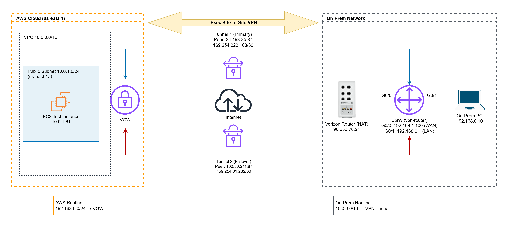

## Overview

This project connects an AWS VPC to a simulated on-premises network in GNS3 through an AWS Site-to-Site VPN. A Cisco IOSv router connects the on-premises network to the VPN. An AWS Virtual Private Gateway connects the VPN to the VPC.

The VPN has two IPsec tunnels. Tunnel 1 carries traffic under normal conditions, and Tunnel 2 acts as a backup. IP SLA checks whether each tunnel can reach AWS. Object tracking uses those results to control which static route the router uses.

The Cisco router uses a private WAN address behind the home router. The home router's public IP address is configured as the AWS Customer Gateway address. A NAT access list prevents traffic to the AWS VPC from being translated. I tested ping and SSH in both directions across the VPN. I also shut down Tunnel 1 to confirm that traffic switched to Tunnel 2.

## Network layout

The on-premises LAN uses `192.168.0.0/24`. The AWS VPC uses `10.0.0.0/16`.

| Component | Interface / location | Address |
|---|---|---|
| On-premises LAN | GNS3 host network | `192.168.0.0/24` |
| `on-prem-pc` | On-premises LAN | `192.168.0.10` |
| Cisco IOSv router | LAN - `GigabitEthernet0/1` | `192.168.0.1/24` |
| Cisco IOSv router | WAN - `GigabitEthernet0/0` | `192.168.1.100/24` |
| Home router | WAN next hop | `192.168.1.1` |
| Home router | Public IP / AWS Customer Gateway address | `96.230.78.21` |
| AWS VPC | `us-east-1` | `10.0.0.0/16` |
| AWS subnet | Public subnet in `us-east-1a` | `10.0.1.0/24` |
| EC2 test instance | Private IP | `10.0.1.61` |

The Cisco router's WAN interface has the private IP address `192.168.1.100`. It connects to the home router at `192.168.1.1`. The home router provides internet access and uses its public IP address, `96.230.78.21`, for the AWS Customer Gateway configuration.

## AWS network

The VPC contains a public subnet in `us-east-1a` and an EC2 instance used to test the VPN connection. DNS resolution and DNS hostnames are enabled for the VPC.

The VPC route table sends traffic for `192.168.0.0/24` through the Virtual Private Gateway. The local route handles traffic between resources inside the VPC.

### VPC overview


### Subnet details


### Route table routes

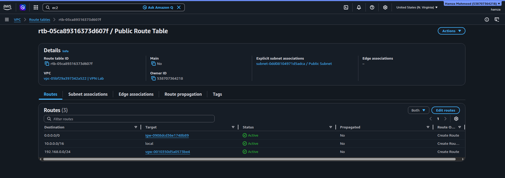

### Route table association


### Site-to-Site VPN

The Customer Gateway uses the home router's public IP address to identify the on-premises VPN device. The Virtual Private Gateway is attached to the VPC and connects it to the VPN.

The VPN uses static routing for the on-premises network `192.168.0.0/24`. AWS provides two IPsec tunnels. Each tunnel has its own AWS public IP address and a pair of inside tunnel addresses from a `/30` network.

### VPN connection overview


| Setting | Tunnel 1 | Tunnel 2 |
|---|---|---|
| Role | Primary | Backup |
| AWS public peer | `34.193.85.87` | `100.50.211.87` |
| On-premises public endpoint | `96.230.78.21` | `96.230.78.21` |
| Cisco tunnel interface | `Tunnel1` | `Tunnel2` |
| AWS inside address | `169.254.222.169/30` | `169.254.81.233/30` |
| On-premises inside address | `169.254.222.170/30` | `169.254.81.234/30` |

The AWS VPN connection uses the Customer Gateway and Virtual Private Gateway. It includes configuration details for both tunnels.

### Tunnel 1 endpoint


### Tunnel 2 endpoint

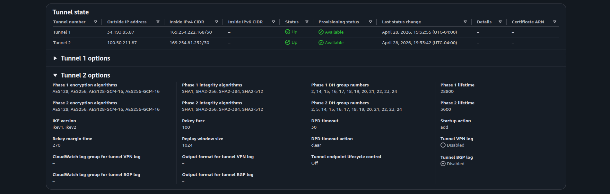

### Customer Gateway


### Virtual Private Gateway

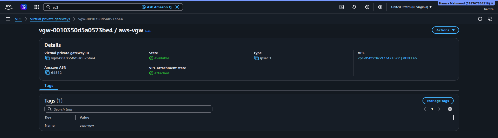

### EC2 test instance

The EC2 instance runs in the public subnet and has the private IP address `10.0.1.61`. Its security group allows ping and SSH traffic between the instance and `on-prem-pc`.

### EC2 instance details

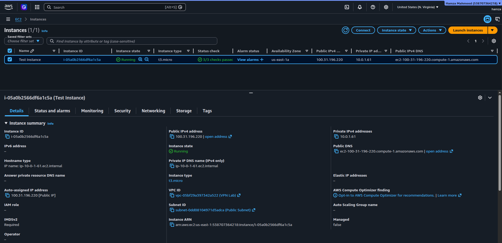

### Security group rules


## On-premises environment

The on-premises network is simulated in GNS3. The Cisco IOSv router connects the LAN to the home router. `GigabitEthernet0/1` connects to the LAN at `192.168.0.0/24`. `GigabitEthernet0/0` connects to the home router's network at `192.168.1.0/24`. The home router provides internet access and NAT. `Tunnel1` and `Tunnel2` connect to the two AWS VPN tunnel endpoints.

### GNS3 topology


The router interfaces are configured as follows:

| Interface | Role | Address | NAT configuration |
|---|---|---|---|
| `GigabitEthernet0/0` | WAN | `192.168.1.100/24` | `ip nat outside` |
| `GigabitEthernet0/1` | LAN | `192.168.0.1/24` | `ip nat inside` |

The default route sends traffic to the home router at `192.168.1.1`. Routes to the AWS VPC use the IPsec tunnels.

## Routing and NAT

The router has a default route toward the home router and two static routes for the AWS VPC:

```text
ip route 0.0.0.0 0.0.0.0 GigabitEthernet0/0 192.168.1.1
ip route 10.0.0.0 255.255.0.0 Tunnel1 track 100
ip route 10.0.0.0 255.255.0.0 Tunnel2 2 track 200
```

Tunnel 1 has an administrative distance of 1, so the router prefers it when it is available. IP SLA 100 and tracking object 100 check the primary tunnel. Tunnel 2 has an administrative distance of 2, so it acts as the backup route. If the primary route is removed, the router uses Tunnel 2.

PAT allows devices on the on-premises LAN to share the router's WAN address for internet access. Traffic to the AWS VPC keeps its original source IP address. This allows AWS to send replies back to `on-prem-pc`. The NAT access list excludes traffic to the AWS VPC from PAT and allows other LAN traffic to use PAT:

```text
ip access-list extended NONAT
 deny ip 192.168.0.0 0.0.0.255 10.0.0.0 0.0.255.255
 permit ip 192.168.0.0 0.0.0.255 any

ip nat inside source list NONAT interface GigabitEthernet0/0 overload
```

The `deny` statement does not block traffic. It prevents packets to the AWS VPC from matching the NAT rule. The `permit` statement allows other LAN traffic to use PAT through the WAN interface.

## VPN tunnel configuration

The Cisco router has one tunnel interface for each AWS IPsec tunnel. Both use `GigabitEthernet0/0` as the source interface. `Tunnel1` connects to the first AWS tunnel address, and `Tunnel2` connects to the second.

The router configuration includes NAT-T and an ISAKMP NAT keepalive with a 10-second interval:

```text
crypto isakmp nat keepalive 10
```

 ## Tunnel monitoring and failover

IP SLA checks whether each tunnel can reach its AWS inside address. Each check sends an ICMP probe every five seconds. Object tracking uses the probe results to determine whether the route through that tunnel should remain active:

```text
ip sla 100
 icmp-echo 169.254.222.169 source-interface Tunnel1
 frequency 5
ip sla schedule 100 life forever start-time now
track 100 ip sla 100 reachability

ip sla 200
 icmp-echo 169.254.81.233 source-interface Tunnel2
 frequency 5
ip sla schedule 200 life forever start-time now
track 200 ip sla 200 reachability
```

If an IP SLA check fails, its tracking object goes Down and the router removes the route through that tunnel. Tunnel 1 is the primary route because it has the lower administrative distance. If Tunnel 1 fails, the router uses Tunnel 2.

## Validation

I checked the router interfaces, routing table, IKE and IPsec security associations, and IP SLA tracking before testing connectivity. Both IPsec tunnels were up.

### Router verification

The interface output shows the WAN and LAN IP addresses and confirms that both tunnel interfaces are up.

#### WAN, LAN, and tunnel interfaces verified

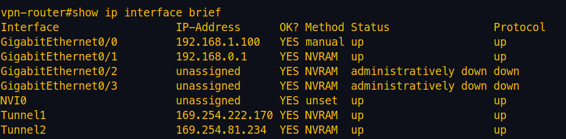

The routing table has routes to the AWS VPC through both tunnels. Tunnel 1 is the primary route with an administrative distance of 1. Tunnel 2 is the backup route with an administrative distance of 2.

#### Primary and backup routes installed


Both AWS peers show `QM_IDLE`, which confirms that the IKE connections are established.

#### Both IKE peers established


The IPsec output shows security associations for both tunnels.

<table>
  <tr>
    <td align="center"><strong>Tunnel 1 IPsec SAs</strong></td>
    <td align="center"><strong>Tunnel 2 IPsec SAs</strong></td>
  </tr>
  <tr>
    <td></td>
    <td>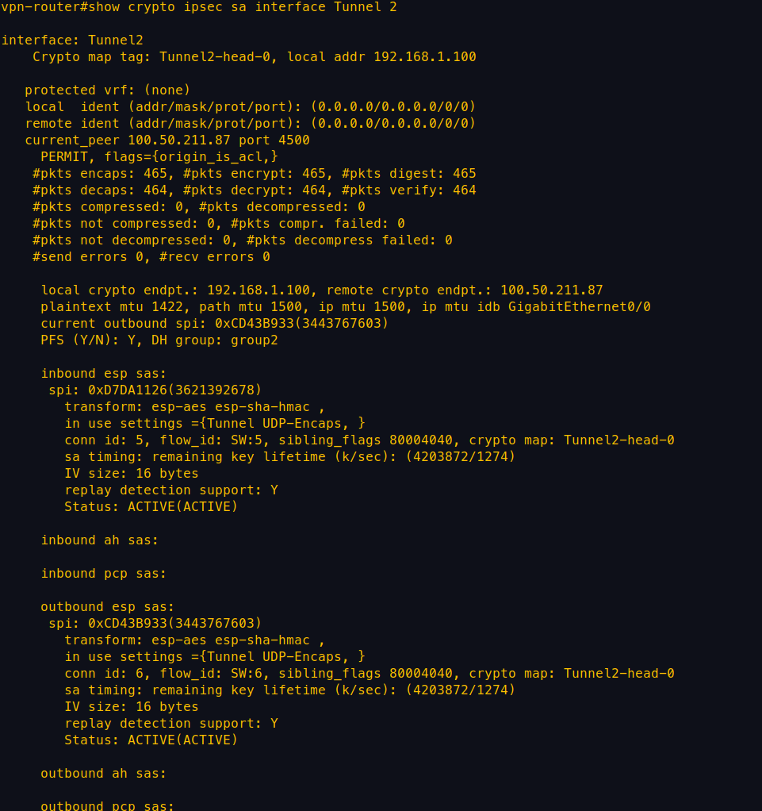</td>
  </tr>
</table>

The tracking output shows whether each IP SLA check is Up or Down. The router uses these states to decide whether to keep each route.

#### Tunnel reachability tracking verified

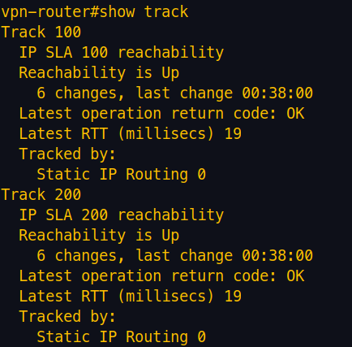

## End-to-end connectivity

I tested ping and SSH between `on-prem-pc` (`192.168.0.10`) and the EC2 instance (`10.0.1.61`) in both directions.

`on-prem-pc` uses an address in the `192.168.0.0/24` subnet:

### `on-prem-pc` IP configuration


Ping worked in both directions across the VPN. SSH connections also succeeded from `on-prem-pc` to the EC2 instance and from the EC2 instance back to `on-prem-pc`.

<table>
  <tr>
    <td align="center"><strong>on-prem-pc to AWS - Ping</strong></td>
    <td align="center"><strong>AWS to on-prem-pc - Ping</strong></td>
  </tr>
  <tr>
    <td></td>
    <td>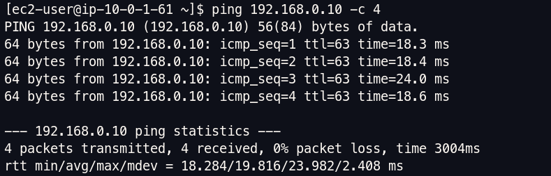</td>
  </tr>
  <tr>
    <td align="center"><strong>on-prem-pc to AWS - SSH</strong></td>
    <td align="center"><strong>AWS to on-prem-pc - SSH</strong></td>
  </tr>
  <tr>
    <td></td>
    <td>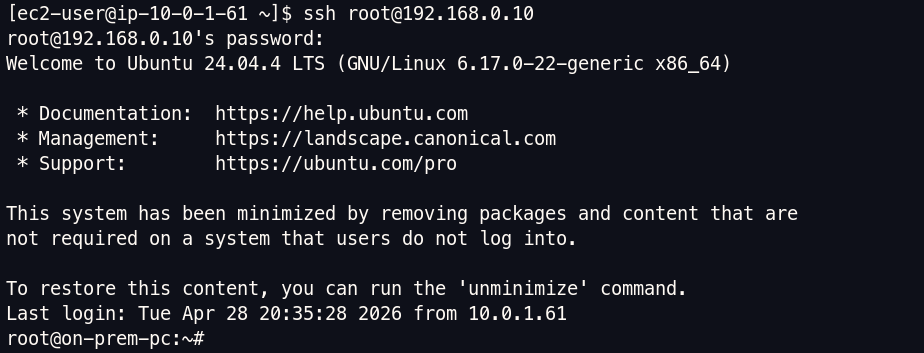</td>
  </tr>
</table>

## Failover test

I shut down Tunnel 1 on the Cisco router to test failover. IP SLA 100 detected that the tunnel was down. Tracking object 100 changed to Down, and the router removed the primary route.

Tunnel 1 went Down, and tracking object 100 changed from Up to Down. Tracking object 200 stayed Up, so Tunnel 2 remained available:

### Tunnel 1 down and tracking state

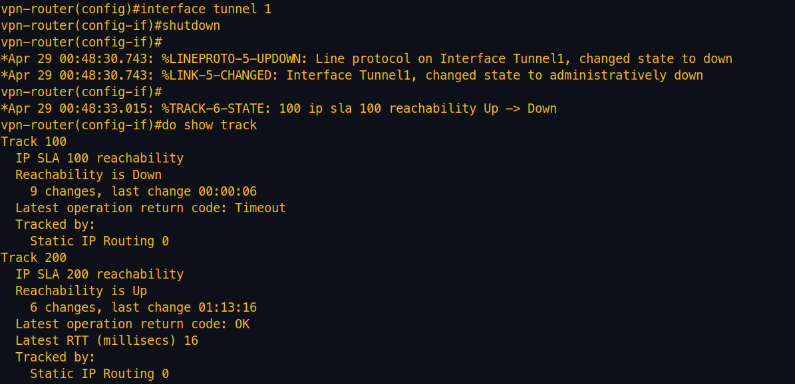

The routing table switched the route to `10.0.0.0/16` to Tunnel 2:

### Backup route installed through Tunnel 2

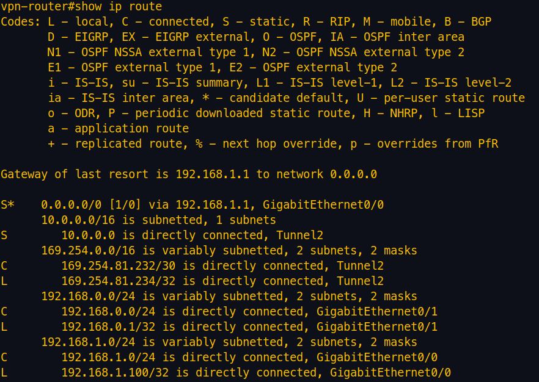

The router continued to reach the AWS VPC through Tunnel 2. The default route through `192.168.1.1` did not change.

## Project files

The project includes the architecture diagram, Cisco router configurations, AWS VPN configuration, and screenshots of the setup and tests.

- **[architecture/](./architecture/)** - PNG architecture diagram and editable draw.io source.
- **[configs/](./configs/)** - Cisco router configurations and the AWS-generated VPN configuration.
- **[screenshots/](./screenshots/)** - AWS configuration, router verification, connectivity tests, and failover evidence.