# 1. AWS Site-to-Site VPN


## Overview

This project covers setting up an AWS Site-to-Site VPN between an AWS VPC and an on-premises network simulated in GNS3. A Cisco IOSv router acts as the Customer Gateway, while an AWS Virtual Private Gateway handles the other end of the connection.

AWS provides two IPsec tunnels for the VPN connection. Both are configured on the Cisco router, with Tunnel 1 used as the primary path and Tunnel 2 as the backup. IP SLA and object tracking monitor tunnel reachability and determine which static route stays active.

Since the Cisco router sits behind a home router, the configuration also needs to account for NAT. This involves excluding AWS-bound traffic from PAT and using NAT Traversal (NAT-T) to allow the VPN connection to work through the upstream router. Connectivity was tested in both directions, followed by a failover test with the primary tunnel taken offline.

## Network layout

The on-premises LAN uses `192.168.0.0/24`, while the AWS VPC uses `10.0.0.0/16`.

| Component | Interface / location | Address |
|---|---|---|
| On-premises LAN | GNS3 host network | `192.168.0.0/24` |
| Cisco IOSv router | LAN - `GigabitEthernet0/1` | `192.168.0.1/24` |
| Cisco IOSv router | WAN - `GigabitEthernet0/0` | `192.168.1.100/24` |
| Home router | WAN next hop | `192.168.1.1` |
| Home router | Public IP / AWS Customer Gateway address | `96.230.78.21` |
| AWS VPC | `us-east-1` | `10.0.0.0/16` |
| AWS subnet | Public subnet in `us-east-1a` | `10.0.1.0/24` |
| EC2 test instance | Private IP | `10.0.1.61` |

The Cisco router's WAN interface uses the private address `192.168.1.100`. The home router performs NAT for internet access. AWS sees the home router's public IP, `96.230.78.21`, which is the address configured on the Customer Gateway.

## AWS network

The AWS environment uses a VPC with the address space `10.0.0.0/16` and a `10.0.1.0/24` subnet in `us-east-1a`. An EC2 instance in the subnet provides a test endpoint for verifying connectivity across the VPN.

DNS resolution and DNS hostnames are enabled on the VPC. The route table directs traffic destined for `192.168.0.0/24` through the Virtual Private Gateway, while the local route handles communication within the VPC's `10.0.0.0/16` address space.

### VPC overview

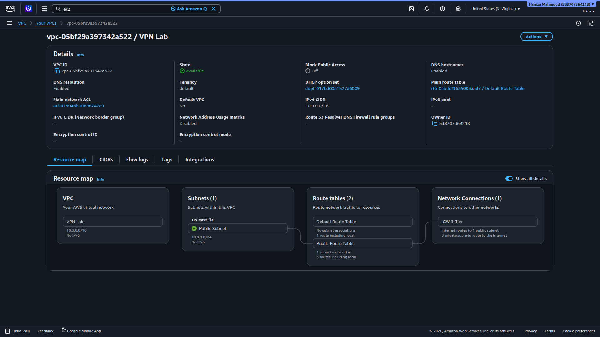

### Subnet details

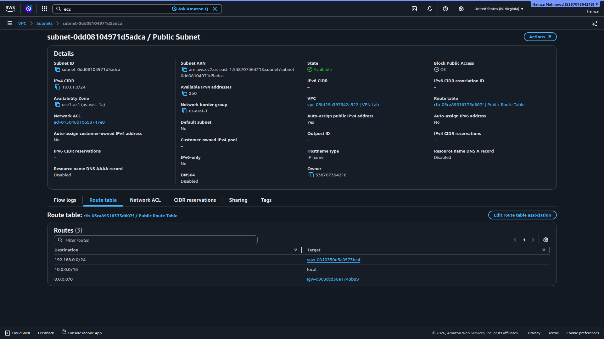

### Route table routes


### Route table association

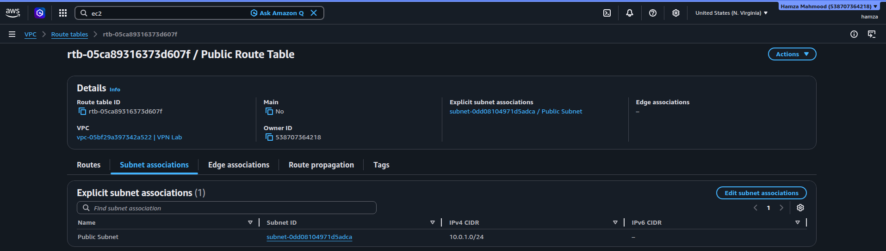

### Site-to-Site VPN

The Customer Gateway represents the on-premises VPN endpoint and uses the home router's public IP address. On the AWS side, the Virtual Private Gateway is attached to the VPC and terminates the VPN connection.

The VPN uses static routing to reach the on-premises network, `192.168.0.0/24`. AWS provides two IPsec tunnels, each with its own public peer address and inside `/30` address range.

### VPN connection overview

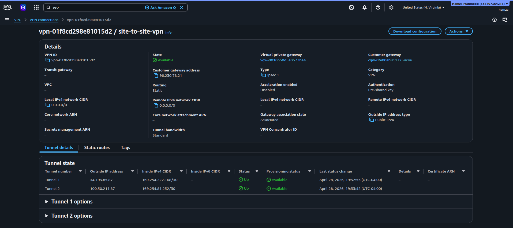

| Setting | Tunnel 1 | Tunnel 2 |
|---|---|---|
| Role | Preferred path | Backup path |
| AWS public peer | `34.193.85.87` | `100.50.211.87` |
| On-premises public endpoint | `96.230.78.21` | `96.230.78.21` |
| Cisco tunnel interface | `Tunnel1` | `Tunnel2` |
| AWS inside address | `169.254.222.169/30` | `169.254.81.233/30` |
| On-premises inside address | `169.254.222.170/30` | `169.254.81.234/30` |

The AWS console shows the status of each tunnel, along with the Customer Gateway and Virtual Private Gateway configuration.

### Tunnel 1 status

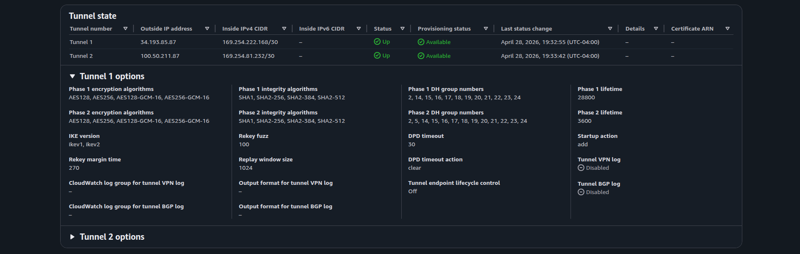

### Tunnel 2 status


### Customer Gateway

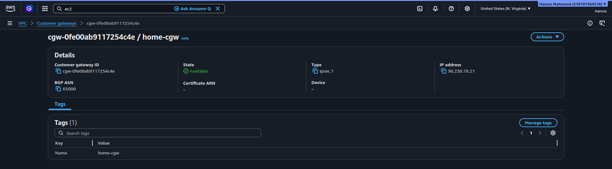

### Virtual Private Gateway


### EC2 test instance

The EC2 instance runs in the public subnet and has the private IP address `10.0.1.61`. Its security group allows ICMP and SSH, which makes it possible to test connectivity and establish SSH sessions between AWS and the on-premises network.

### EC2 instance details


### Security group rules

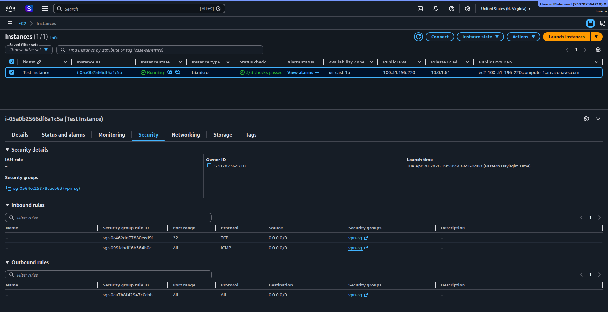

## On-premises environment

GNS3 simulates the on-premises network. A Cisco IOSv router connects the LAN to the home router. `GigabitEthernet0/1` connects to the `192.168.0.0/24` LAN, while `GigabitEthernet0/0` connects to the `192.168.1.0/24` network.

### GNS3 topology

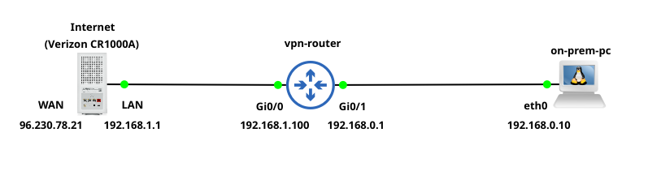

The router interfaces are configured as follows:

| Interface | Role | Address | NAT configuration |
|---|---|---|---|
| `GigabitEthernet0/0` | WAN | `192.168.1.100/24` | `ip nat outside` |
| `GigabitEthernet0/1` | LAN | `192.168.0.1/24` | `ip nat inside` |

Internet-bound traffic leaves through the home router at `192.168.1.1`, while traffic destined for the AWS VPC is routed through the IPsec tunnel interfaces.

## Routing and NAT

The router has a default route toward the home router and two static routes for the AWS VPC:

```text
ip route 0.0.0.0 0.0.0.0 GigabitEthernet0/0 192.168.1.1
ip route 10.0.0.0 255.255.0.0 Tunnel1 track 100
ip route 10.0.0.0 255.255.0.0 Tunnel2 2 track 200
```

Tunnel 1 is the preferred route, with an administrative distance of 1. Tunnel 2 has a higher administrative distance of 2, so it becomes the preferred path when the primary route is withdrawn. IP SLA and object tracking control when each route is installed.

PAT is also configured for general internet access. Traffic between the on-premises LAN and AWS needs to retain its original source address. The NAT access list excludes that traffic from translation and permits other LAN traffic to use PAT:

```text
ip access-list extended NONAT
 deny ip 192.168.0.0 0.0.0.255 10.0.0.0 0.0.255.255
 permit ip 192.168.0.0 0.0.0.255 any

ip nat inside source list NONAT interface GigabitEthernet0/0 overload
```

The `deny` statement does not drop the VPN traffic. It prevents packets destined for the AWS VPC from matching the NAT rule. Other matching LAN traffic can still be translated through the WAN interface.

## VPN tunnel configuration

The Cisco router has a separate tunnel interface for each AWS IPsec tunnel. Both use `GigabitEthernet0/0` as their source interface, but each connects to a different AWS public peer address.

Since the Cisco router is behind the home router's NAT, NAT Traversal (NAT-T) is required. During IKE negotiation, the peers detect the NAT device and encapsulate ESP traffic in UDP, typically over port 4500. This allows the IPsec traffic to pass through the home router.

The router also has an ISAKMP NAT keepalive configured:

```text
crypto isakmp nat keepalive 10
```

This configures the NAT keepalive interval to 10 seconds. When NAT-T is in use, the keepalive helps prevent the home router from expiring its UDP mapping during periods of inactivity. NAT-T handles ESP encapsulation, while the keepalive helps maintain the NAT mapping. The command does not enable NAT-T or keep the IKE/IPsec security associations alive by itself.

## Tunnel monitoring and failover

IP SLA and object tracking monitor both tunnels. Each IP SLA operation periodically sends ICMP probes to the AWS inside address of its corresponding tunnel:

```text
ip sla 100
 icmp-echo 169.254.222.169 source-interface Tunnel1
 frequency 5
ip sla schedule 100 life forever start-time now
track 100 ip sla 100 reachability

ip sla 200
 icmp-echo 169.254.81.233 source-interface Tunnel2
 frequency 5
ip sla schedule 200 life forever start-time now
track 200 ip sla 200 reachability
```

If an IP SLA probe fails, its tracking object changes state and the associated static route is withdrawn. Tunnel 1 is normally preferred because it has the lower administrative distance. If it becomes unavailable, the router can use the floating static route through Tunnel 2 instead.

## Validation

The router interfaces, routing table, IKE and IPsec security associations, and IP SLA tracking state were checked before connectivity testing. These checks verified that both tunnels were established.

### Router verification

The interface status verifies the WAN and LAN addressing, along with the state of both tunnel interfaces.

#### Router interface status


The routing table confirms that both routes to the AWS VPC are configured. Tunnel 1 is preferred with an administrative distance of 1, while Tunnel 2 has an administrative distance of 2.

#### Router routing table

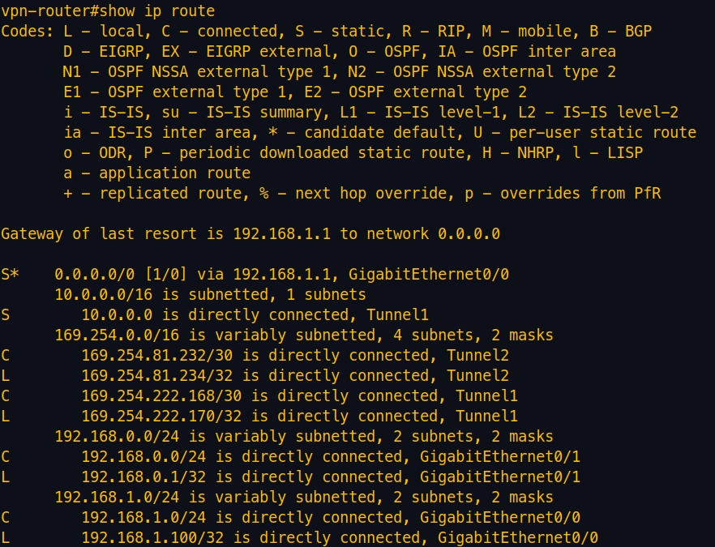

Both AWS peers appear in the `QM_IDLE` state. This indicates that IKE negotiation and Quick Mode have completed successfully.

#### IKE security associations

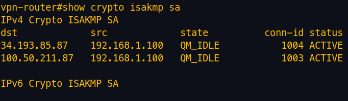

The IPsec security associations show that both tunnels have established their SAs.

<table>
  <tr>
    <td align="center"><strong>Tunnel 1 IPsec SAs</strong></td>
    <td align="center"><strong>Tunnel 2 IPsec SAs</strong></td>
  </tr>
  <tr>
    <td>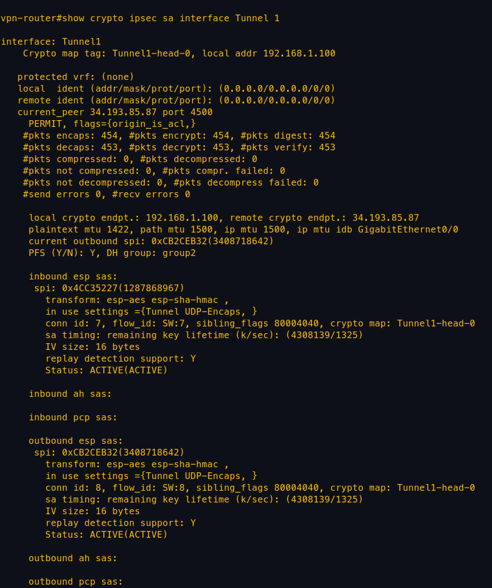</td>
    <td></td>
  </tr>
</table>

The tracking output shows the reachability state reported by both IP SLA operations, which determines whether their associated static routes remain active.

#### IP SLA and object tracking


## End-to-end connectivity

The on-premises host (`192.168.0.10`) and EC2 instance (`10.0.1.61`) were used to test connectivity across the VPN in both directions using ICMP and SSH.

The on-premises test host uses an address in the `192.168.0.0/24` subnet:

### On-premises host IP configuration

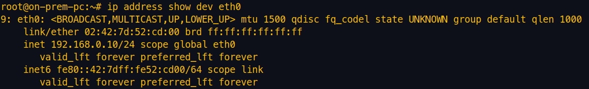

Both hosts were able to ping each other across the VPN. SSH sessions were also established in both directions. These tests verified connectivity over TCP port 22.

<table>
  <tr>
    <td align="center"><strong>On-premises to AWS - Ping</strong></td>
    <td align="center"><strong>AWS to on-premises - Ping</strong></td>
  </tr>
  <tr>
    <td>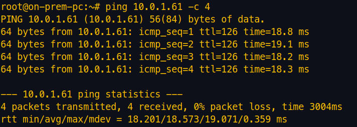</td>
    <td></td>
  </tr>
  <tr>
    <td align="center"><strong>On-premises to AWS - SSH</strong></td>
    <td align="center"><strong>AWS to on-premises - SSH</strong></td>
  </tr>
  <tr>
    <td>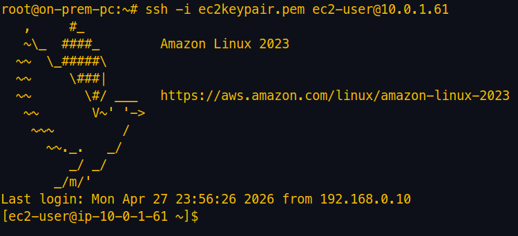</td>
    <td></td>
  </tr>
</table>

## Failover test

To test the backup path, Tunnel 1 was shut down on the Cisco router. IP SLA 100 detected that the primary tunnel was unreachable. Tracking object 100 changed state, and the router withdrew the associated static route.

Tunnel 1 went down, and tracking object 100 changed from Up to Down. Tracking object 200 remained Up. This confirmed that the backup tunnel was still reachable:

### Tunnel 1 down and tracking state


The routing table then installs the route to `10.0.0.0/16` through Tunnel 2:

### AWS VPC route through Tunnel 2


With Tunnel 1 unavailable, the router uses Tunnel 2 to reach the AWS VPC. The default route through `192.168.1.1` remains unchanged.

## Project files

The repository includes the architecture diagram, Cisco router configurations, AWS VPN configuration, and screenshots from the deployment and testing.

- **[architecture/](./architecture/)** - PNG architecture diagram and editable draw.io source.
- **[configs/](./configs/)** - Cisco router configurations and the AWS-generated VPN configuration.
- **[screenshots/](./screenshots/)** - AWS configuration, router verification, connectivity tests, and failover evidence.