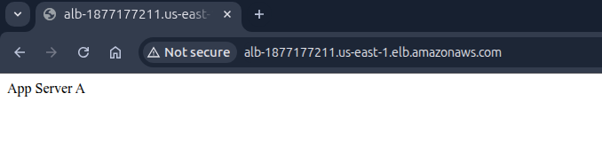
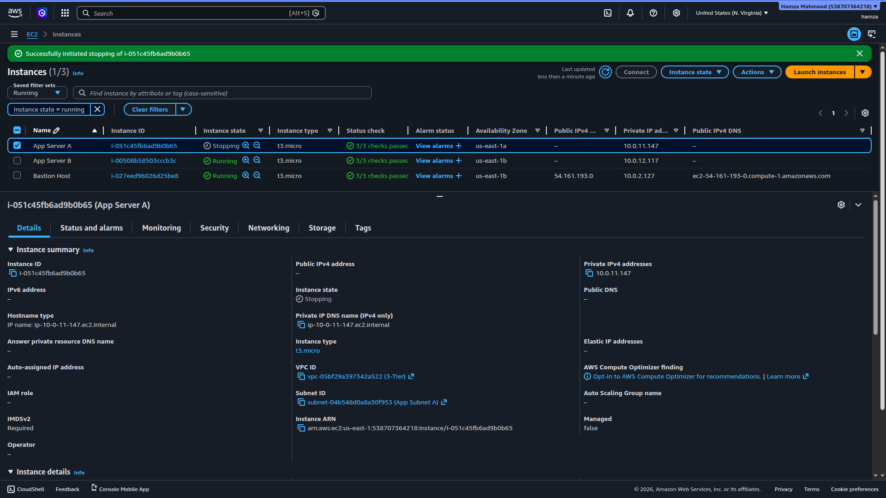
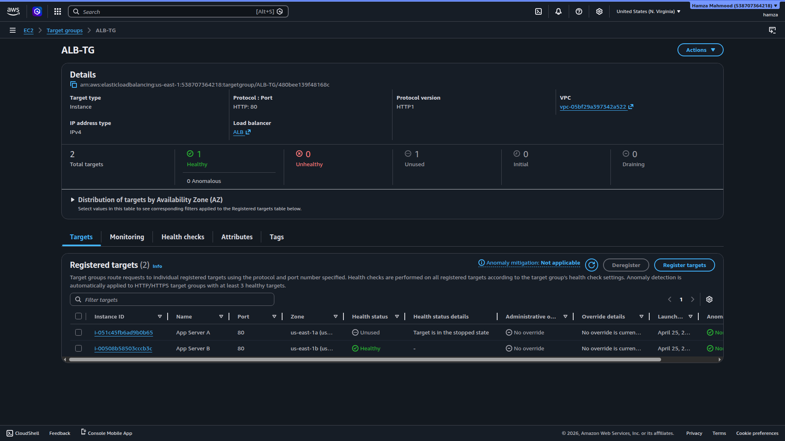
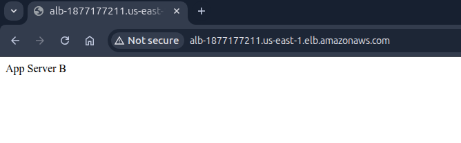
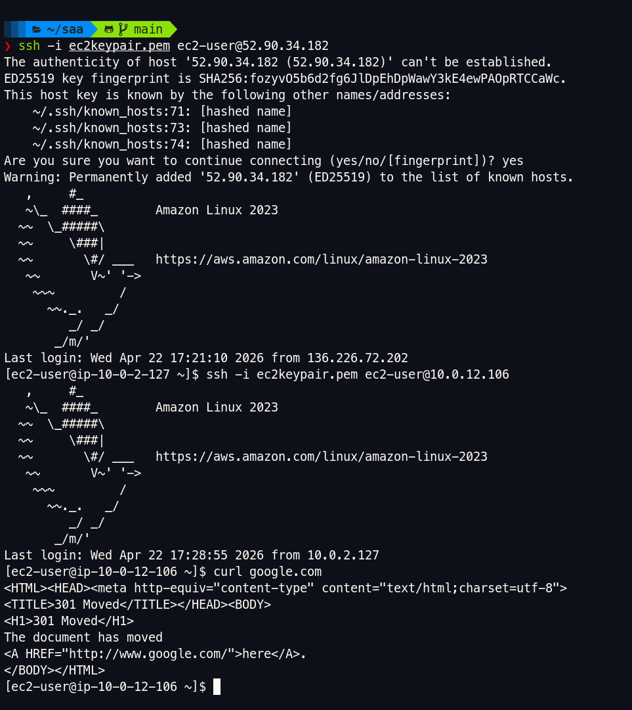
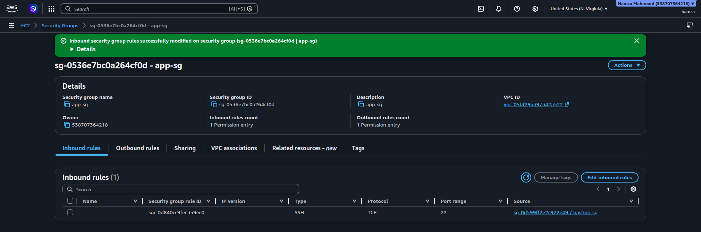
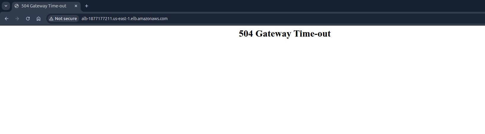

# 2. AWS Three-Tier VPC Architecture


## Overview

I built this three-tier AWS network to explore how the web, application, and database layers communicate across Availability Zones.

The design uses an internet-facing Application Load Balancer (ALB), two EC2 application instances in private subnets, and Amazon RDS for MySQL with Multi-AZ deployment. A bastion host provides administrative access to the application instances, while a Regional NAT Gateway gives them outbound internet access.

I focused on the network layout, security group rules, private connectivity, and the behavior of the application when one EC2 instance was unavailable.

## Network layout

The VPC uses `10.0.0.0/16` in `us-east-1`. I divided it into public, application, and database subnets across `us-east-1a` and `us-east-1b`.

| Tier | Subnet | Availability Zone | CIDR |
|---|---|---|---|
| Public | Public Subnet A | `us-east-1a` | `10.0.1.0/24` |
| Public | Public Subnet B | `us-east-1b` | `10.0.2.0/24` |
| Application | Private App Subnet A | `us-east-1a` | `10.0.11.0/24` |
| Application | Private App Subnet B | `us-east-1b` | `10.0.12.0/24` |
| Database | Private DB Subnet A | `us-east-1a` | `10.0.21.0/24` |
| Database | Private DB Subnet B | `us-east-1b` | `10.0.22.0/24` |

Each tier has its own route table:

| Route table | Default route | Purpose |
|---|---|---|
| Public | `0.0.0.0/0` → Internet Gateway | Internet access for public resources |
| Private App | `0.0.0.0/0` → Regional NAT Gateway | Outbound internet access for application instances |
| Private DB | No internet default route | Keeps the database tier off the internet route |

The VPC local route allows communication between subnets. I left the database route table without a default route to either the Internet Gateway or NAT Gateway.

**Network configuration:**

- VPC and subnet layout: [VPC overview](screenshots/1-1-vpc-summary-page.png) · [Subnet list](screenshots/2-1-subnet-list.png)
- Public subnet configuration: [Public Subnet A](screenshots/2-2-1-public-subnet-a.png) · [Public Subnet B](screenshots/2-2-2-public-subnet-b.png)
- Application subnet configuration: [Private App Subnet A](screenshots/2-2-3-app-subnet-a.png) · [Private App Subnet B](screenshots/2-2-4-app-subnet-b.png)
- Database subnet configuration: [Private DB Subnet A](screenshots/2-2-5-db-subnet-a.png) · [Private DB Subnet B](screenshots/2-2-6-db-subnet-b.png)
- Route table routes and subnet associations: [Public routes](screenshots/5-1-1-public-route-table-routes.png) · [Public subnet associations](screenshots/5-1-2-public-route-table-subnets.png) · [App routes](screenshots/5-2-1-app-route-table-routes.png) · [App subnet associations](screenshots/5-2-2-app-route-table-subnets.png) · [DB routes](screenshots/5-3-1-db-route-table-routes.png) · [DB subnet associations](screenshots/5-3-2-db-route-table-subnets.png)

## Network security

I used security groups to define the allowed traffic between each tier. The rules follow the application path from the internet to the ALB, from the ALB to the application instances, and from the application instances to RDS.

1. Internet clients connect to the ALB over HTTP/HTTPS.
2. The ALB forwards HTTP traffic to the application instances.
3. The application instances connect to RDS over MySQL TCP port `3306`.
4. The bastion host provides SSH access to the private application instances.

| Security group | Inbound access |
|---|---|
| `alb-sg` | HTTP (80) and HTTPS (443) from `0.0.0.0/0` |
| `app-sg` | HTTP (80) from `alb-sg`; SSH (22) from `bastion-sg` |
| `db-sg` | MySQL (3306) from `app-sg` |
| `bastion-sg` | SSH (22) from `0.0.0.0/0` |

The application and database instances do not accept direct inbound internet traffic. The `db-sg` rule also limits MySQL access to the application tier.

**Security group configuration:** [ALB security group](screenshots/6-1-alb-security-group.png) · [Application security group](screenshots/6-2-app-security-group.png) · [Database security group](screenshots/6-3-db-security-group.png) · [Bastion security group](screenshots/6-4-bastion-sg.png)

## Internet Gateway and NAT Gateway

The Internet Gateway provides internet connectivity for resources in the public subnets. I configured a Regional NAT Gateway for outbound connections from the private application subnets.

This gives the application instances access to package repositories and other external services without public IP addresses or direct inbound internet access.


The NAT Gateway uses Elastic IP addresses:

- [NAT Gateway Elastic IPs](screenshots/4-2-nat-gateway-eips.png)
- [Elastic IP details](screenshots/4-3-nat-eips.png)

## Application servers

I deployed two EC2 application instances in the private application subnets, one in each Availability Zone. Both use Amazon Linux and Apache HTTP Server (`httpd`).

Each instance serves a simple page with its own name. This made it possible to identify which instance handled a request through the ALB and verify that both targets received traffic.

EC2 user data installs Apache, starts and enables the service, and writes the instance name to the default web page.

### App Server A user data

[`configs/app-server-a.sh`](configs/app-server-a.sh):

```bash
#!/bin/bash
dnf update -y
dnf install -y httpd

systemctl start httpd
systemctl enable httpd

echo "App Server A" > /var/www/html/index.html
```

### App Server B user data

[`configs/app-server-b.sh`](configs/app-server-b.sh):

```bash
#!/bin/bash
dnf update -y
dnf install -y httpd

systemctl start httpd
systemctl enable httpd

echo "App Server B" > /var/www/html/index.html
```

The scripts use the same setup. Only the final `echo` command differs, so each page identifies its EC2 instance.

**EC2 configuration:** [EC2 instance list](screenshots/7-1-instance-list-view.png) · [App Server A](screenshots/7-2-app-instance-a-detail.png) · [App Server B](screenshots/7-3-app-instance-b-detail.png)

## Application Load Balancer

The internet-facing ALB runs in the public subnets. Its target group contains both EC2 application instances in the private subnets, and health checks determine which targets can receive requests.

The ALB forwards HTTP requests to the application instances. The `app-sg` security group allows HTTP only from the `alb-sg` security group, rather than from the internet.

**ALB configuration:** [ALB overview](screenshots/8-1-alb-overview.png) · [ALB resource map](screenshots/8-2-alb-resource-map.png) · [ALB security group](screenshots/8-3-alb-security-group.png) · [Target group](screenshots/8-4-alb-target-group.png) · [Target health checks](screenshots/8-5-target-group-health-check.png)

## Bastion host

I placed the bastion host in a public subnet so it could provide SSH access to the private application instances. The `app-sg` security group allows SSH only from `bastion-sg`, so the application instances do not accept SSH directly from the internet. The bastion security group allowed SSH from 0.0.0.0/0 during this project. In a production environment, I would restrict that rule to a trusted source IP range.


## Amazon RDS for MySQL

Amazon RDS for MySQL runs in the private DB subnet group with Multi-AZ enabled. The primary instance is in `us-east-1a`, and the standby is in `us-east-1b`.

The database subnets have no internet default route. The `db-sg` security group allows MySQL traffic on TCP port `3306` only from the `app-sg` security group.


## Validation

I tested the main network paths and application behavior after the configuration was in place. The tests covered load balancing, the loss of one application instance, database connectivity, and outbound access through the NAT Gateway.

### Load balancing

Requests to the ALB DNS name returned either App Server A or App Server B. This verified that both instances received traffic through the target group.



### Application instance failure

I stopped App Server A to test whether the ALB would continue to serve requests. After the health check marked it unhealthy, the ALB sent requests to App Server B.







The application remained reachable while one EC2 instance was unavailable.

### Application-to-database connectivity

I established a connection from the application instance to the RDS MySQL endpoint over TCP port `3306`. The connection used the VPC's private networking, and the `db-sg` security group allowed traffic from `app-sg`.


### Outbound access through NAT

A private application instance successfully accessed the internet through the Regional NAT Gateway. This verified that the private app route table sent its default route to the NAT Gateway.



## Security group failure test

I removed `alb-sg` from the inbound rules of `app-sg` to test the effect of a missing ALB-to-app rule. The ALB could no longer reach the application instances, and requests returned a `504 Gateway Timeout`.

The test demonstrated the role of the ALB-to-app security group rule. Without inbound HTTP access from alb-sg, the ALB could not reach the application targets.






## Project files

The project includes the architecture diagram, EC2 user-data scripts, and screenshots from the AWS configuration and validation.

- **[architecture/](./architecture/)** — PNG architecture diagram and editable draw.io source.
- **[configs/](./configs/)** — EC2 user-data scripts for App Server A and App Server B.
- **[screenshots/](./screenshots/)** — VPC, subnet, route table, security group, EC2, ALB, RDS, NAT, and validation evidence.