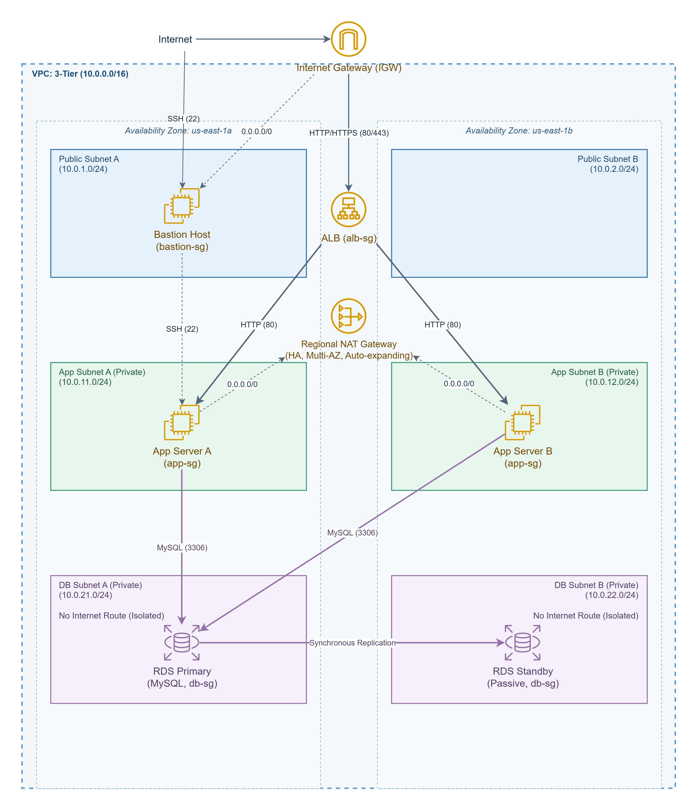
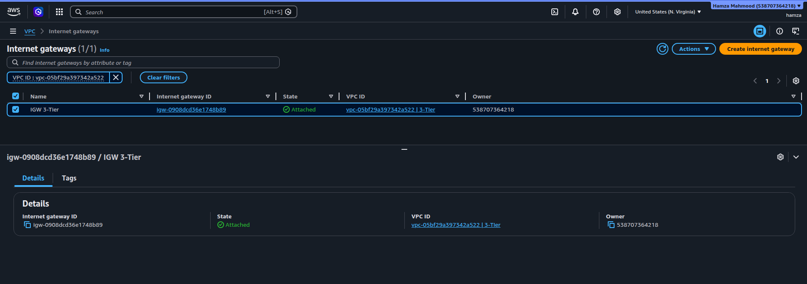
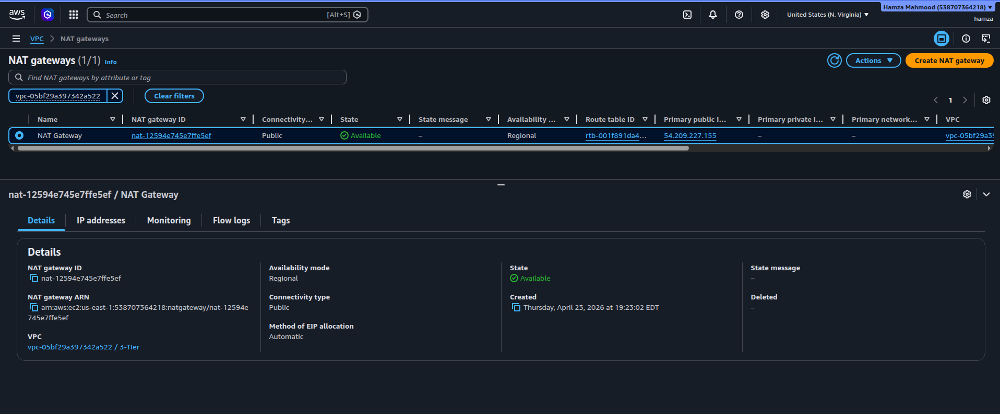
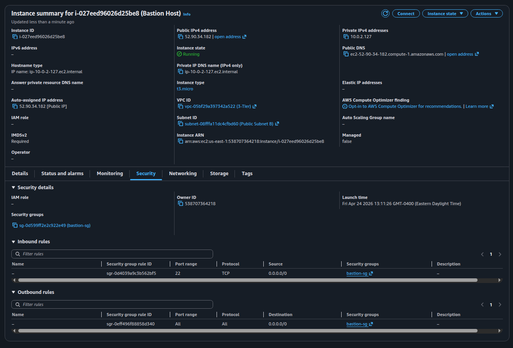
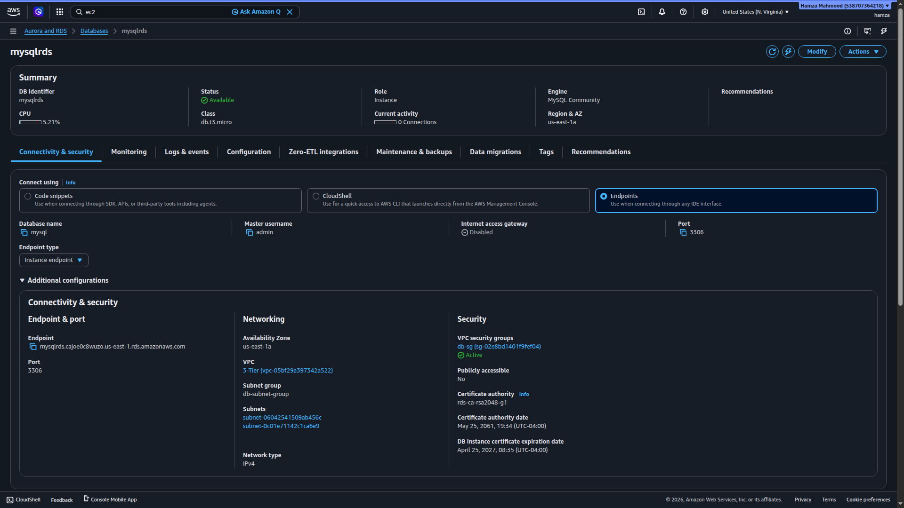
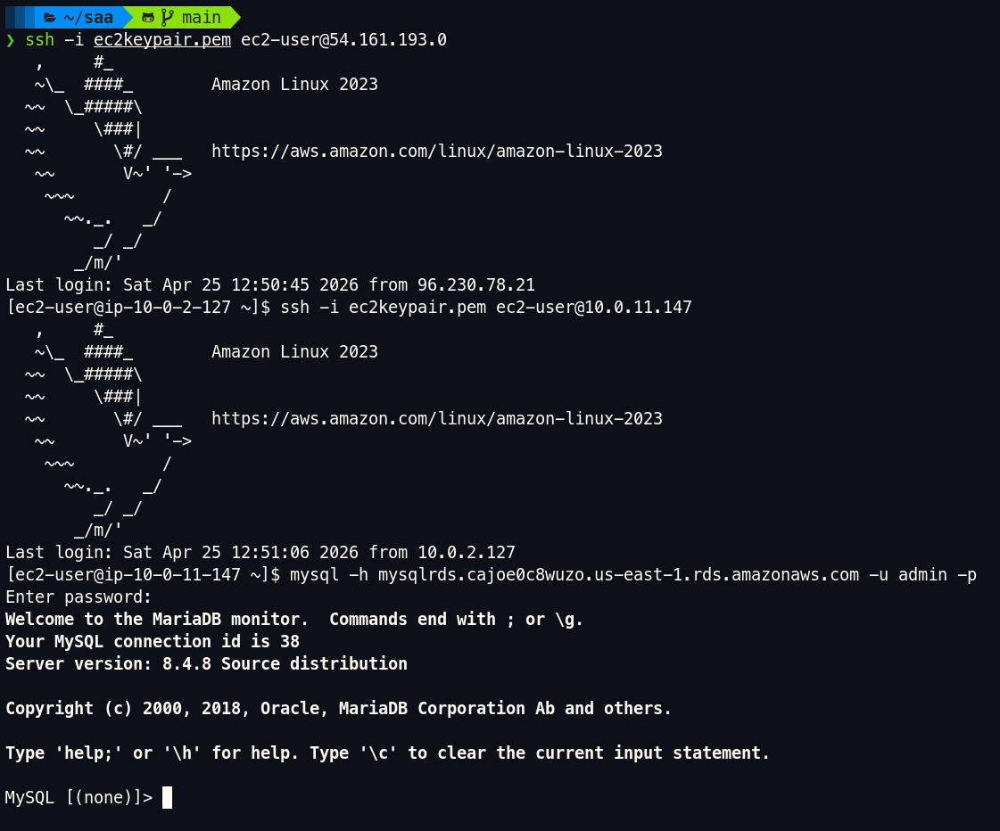
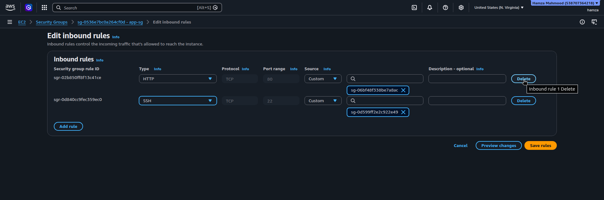

# 2. AWS Three-Tier VPC Architecture



## Overview

This project covers a three-tier application environment in AWS across two Availability Zones. An internet-facing Application Load Balancer (ALB) handles incoming web requests and forwards them to EC2 application servers in private subnets. Amazon RDS for MySQL provides the database tier, with Multi-AZ deployment enabled.

The public subnets contain the ALB and a bastion host. The application instances run in private subnets, while the database is in private DB subnets without an internet default route. Security groups control traffic between the tiers, and a Regional NAT Gateway provides outbound internet access for the application instances.

The ALB was tested while both application instances were available. One instance was then stopped to check whether requests continued reaching the other. Connectivity from an application instance to RDS and outbound internet access through the NAT Gateway were also tested. Finally, the ALB security group was removed from the application security group to test the effect of a missing ALB-to-app rule.

## Network layout

The VPC uses `10.0.0.0/16` in `us-east-1`. The public, application, and database tiers each have subnets in `us-east-1a` and `us-east-1b`.

| Tier | Subnet | Availability Zone | CIDR |
|---|---|---|---|
| Public | Public Subnet A | `us-east-1a` | `10.0.1.0/24` |
| Public | Public Subnet B | `us-east-1b` | `10.0.2.0/24` |
| Application | Private App Subnet A | `us-east-1a` | `10.0.11.0/24` |
| Application | Private App Subnet B | `us-east-1b` | `10.0.12.0/24` |
| Database | Private DB Subnet A | `us-east-1a` | `10.0.21.0/24` |
| Database | Private DB Subnet B | `us-east-1b` | `10.0.22.0/24` |

Separate route tables handle traffic for the public, application, and database subnets:

| Route table | Default route | Purpose |
|---|---|---|
| Public | `0.0.0.0/0` → Internet Gateway | Internet connectivity for public resources |
| Private App | `0.0.0.0/0` → Regional NAT Gateway | Outbound internet access for application instances |
| Private DB | No internet default route | Keeps the database tier off the direct internet route |

The VPC's local route allows communication between its subnets. The database route table has no default route to the Internet Gateway or NAT Gateway.

**Screenshots:**

- VPC and subnet layout: [VPC overview](screenshots/1-1-vpc-summary-page.png) · [Subnet list](screenshots/2-1-subnet-list.png)
- Public subnet configuration: [Public Subnet A](screenshots/2-2-1-public-subnet-a.png) · [Public Subnet B](screenshots/2-2-2-public-subnet-b.png)
- Application subnet configuration: [Private App Subnet A](screenshots/2-2-3-app-subnet-a.png) · [Private App Subnet B](screenshots/2-2-4-app-subnet-b.png)
- Database subnet configuration: [Private DB Subnet A](screenshots/2-2-5-db-subnet-a.png) · [Private DB Subnet B](screenshots/2-2-6-db-subnet-b.png)
- Route table configuration and associations: [Public routes](screenshots/5-1-1-public-route-table-routes.png) · [Public subnet associations](screenshots/5-1-2-public-route-table-subnets.png) · [App routes](screenshots/5-2-1-app-route-table-routes.png) · [App subnet associations](screenshots/5-2-2-app-route-table-subnets.png) · [DB routes](screenshots/5-3-1-db-route-table-routes.png) · [DB subnet associations](screenshots/5-3-2-db-route-table-subnets.png)

## Network security

The security groups allow the traffic needed between the tiers:

1. Internet clients connect to the ALB over HTTP/HTTPS.
2. The ALB forwards HTTP traffic to the application instances.
3. The application instances connect to RDS over MySQL TCP port `3306`.
4. The bastion host provides SSH access to the private application instances.

| Security group | Inbound access |
|---|---|
| `alb-sg` | HTTP (80) and HTTPS (443) from `0.0.0.0/0` |
| `app-sg` | HTTP (80) from `alb-sg`; SSH (22) from `bastion-sg` |
| `db-sg` | MySQL (3306) from `app-sg` |
| `bastion-sg` | SSH (22) from `0.0.0.0/0` |

The application and database instances are not open to direct inbound internet traffic. In addition, the `db-sg` allows MySQL connections only from `app-sg`.

**Screenshots:** [ALB security group](screenshots/6-1-alb-security-group.png) · [Application security group](screenshots/6-2-app-security-group.png) · [Database security group](screenshots/6-3-db-security-group.png) · [Bastion security group](screenshots/6-4-bastion-sg.png)

## Internet Gateway and NAT Gateway

An Internet Gateway provides internet connectivity for resources in the public subnets. A Regional NAT Gateway allows the private application instances to make outbound internet connections.

The application instances can reach the internet through the NAT Gateway without having public IP addresses or accepting direct inbound connections from the internet.





The NAT Gateway uses Elastic IP addresses:

- [NAT Gateway Elastic IPs](screenshots/4-2-nat-gateway-eips.png)
- [Elastic IP details](screenshots/4-3-nat-eips.png)

## Application servers

Two EC2 application instances run in the private application subnets, one in each Availability Zone. Both use Amazon Linux and Apache HTTP Server (`httpd`). Each server displays its name on a simple web page. This identifies the instance that responded to a request through the ALB.

EC2 user data sets up both instances. It installs Apache, starts and enables the service, and writes the server name to the default web page.

### App Server A user data

[`configs/app-server-a.sh`](configs/app-server-a.sh):

```bash
#!/bin/bash
dnf update -y
dnf install -y httpd

systemctl start httpd
systemctl enable httpd

echo "App Server A" > /var/www/html/index.html
```

### App Server B user data

[`configs/app-server-b.sh`](configs/app-server-b.sh):

```bash
#!/bin/bash
dnf update -y
dnf install -y httpd

systemctl start httpd
systemctl enable httpd

echo "App Server B" > /var/www/html/index.html
```

Both scripts use the same setup. The final `echo` command differs so the page identifies which instance handled the request.

**Screenshots:** [EC2 instance list](screenshots/7-1-instance-list-view.png) · [App Server A](screenshots/7-2-app-instance-a-detail.png) · [App Server B](screenshots/7-3-app-instance-b-detail.png)

## Application Load Balancer

The internet-facing ALB runs in the public subnets, and its target group contains both EC2 application instances in the private subnets. Health checks determine which instances can receive traffic.

The ALB forwards HTTP requests to the application instances. The `app-sg` security group allows HTTP traffic from the `alb-sg` security group, rather than accepting HTTP directly from the internet.

**Screenshots:** [ALB overview](screenshots/8-1-alb-overview.png) · [ALB resource map](screenshots/8-2-alb-resource-map.png) · [ALB security group](screenshots/8-3-alb-security-group.png) · [Target group](screenshots/8-4-alb-target-group.png) · [Target health checks](screenshots/8-5-target-group-health-check.png)

## Bastion host

The bastion host sits in a public subnet and provides SSH access to the private application instances. The `app-sg` security group allows SSH only from the `bastion-sg` security group, so the application instances do not accept SSH directly from the internet.



## Amazon RDS for MySQL

Amazon RDS for MySQL runs in the private DB subnet group with Multi-AZ enabled. The primary instance is in `us-east-1a`, with a standby in `us-east-1b`.

The database subnets have no internet default route. The `db-sg` security group allows MySQL traffic on TCP port `3306` only from the `app-sg` security group.



## Validation

The following tests checked the network configuration and application behavior.

### Load balancing

Requests to the ALB's DNS name returned either App Server A or App Server B. This confirmed that traffic reached both instances.


### Application instance failure

App Server A was stopped to check whether the ALB would keep serving requests. After the health check marked it unhealthy, the ALB sent requests to App Server B.


The application remained reachable when one EC2 instance was unavailable. An entire Availability Zone failure was not tested.

### Application-to-database connectivity

A connection from the application instance to the RDS MySQL endpoint was established over TCP port `3306`. The connection used the VPC's private networking. The `db-sg` security group allowed traffic from the `app-sg` security group.



### Outbound access through NAT

A private application instance successfully accessed the internet through the Regional NAT Gateway. This confirmed that the private app route table used the NAT Gateway for its default route.


## Security group failure test

To test a missing ALB-to-app rule, the `alb-sg` security group was removed from the inbound rules of the `app-sg` security group. The ALB could no longer reach the application instances, and requests returned a `504 Gateway Timeout`.

The result confirmed that the `app-sg` security group must allow inbound HTTP from the `alb-sg` security group for the ALB to reach the application instances.




## Project files

The project includes the architecture diagram, EC2 user-data scripts, and screenshots of the AWS configuration and tests.

- **[architecture/](./architecture/)** — PNG architecture diagram and editable draw.io source.
- **[configs/](./configs/)** — EC2 user-data scripts for App Server A and App Server B.
- **[screenshots/](./screenshots/)** — VPC, subnet, route table, security group, EC2, ALB, RDS, NAT, and validation evidence.