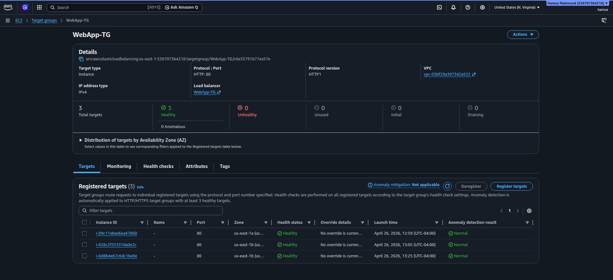

# 3. AWS Web App Infrastructure


## Overview

This project uses an Application Load Balancer (ALB) and an Auto Scaling Group to host a web application in AWS. The ALB receives web requests in the public subnets and forwards them to EC2 instances in private application subnets across two Availability Zones.

The Auto Scaling Group starts with two instances and can scale out to three when average CPU utilization reaches its target. It also replaces an instance if it is terminated. A Regional NAT Gateway provides outbound internet access for the private instances.

Testing covered three things: whether the ALB sent requests to both instances, whether CPU load triggered scale-out, and whether the Auto Scaling Group replaced a terminated instance.

## Network layout

The VPC uses the `10.0.0.0/16` address range in `us-east-1`, with public and private application subnets in `us-east-1a` and `us-east-1b`.

| Tier | Subnet | Availability Zone | CIDR |
|---|---|---|---|
| Public | Public Subnet A | `us-east-1a` | `10.0.1.0/24` |
| Public | Public Subnet B | `us-east-1b` | `10.0.2.0/24` |
| Application | Private App Subnet A | `us-east-1a` | `10.0.11.0/24` |
| Application | Private App Subnet B | `us-east-1b` | `10.0.12.0/24` |

An Internet Gateway provides internet connectivity for the public subnets. A Regional NAT Gateway gives the private instances outbound internet access.

**Screenshots:** [VPC overview](screenshots/1-1-vpc-summary-page.png) · [Subnet list](screenshots/2-1-subnet-list.png) · [Public Subnet A](screenshots/2-2-1-public-subnet-a.png) · [Public Subnet B](screenshots/2-2-2-public-subnet-b.png) · [Private App Subnet A](screenshots/2-2-3-app-subnet-a.png) · [Private App Subnet B](screenshots/2-2-4-app-subnet-b.png)

## Routing and internet access

The public route table sends the default route (`0.0.0.0/0`) to the Internet Gateway. The private application route table sends its default route to the Regional NAT Gateway. This lets EC2 instances download packages and updates without public IP addresses.

- [Public route table routes](screenshots/5-1-1-public-route-table-routes.png)
- [Public route table associations](screenshots/5-1-2-public-route-table-subnets.png)
- [Private app route table routes](screenshots/5-2-1-app-route-table-routes.png)
- [Private app route table associations](screenshots/5-2-2-app-route-table-subnets.png)
- [Internet Gateway](screenshots/3-1-internet-gateway.png)
- [Regional NAT Gateway](screenshots/4-1-nat-gateway.png)

## Network security

| Security group | Inbound access |
|---|---|
| `alb-sg` | HTTP (80) and HTTPS (443) from `0.0.0.0/0` |
| `app-sg` | HTTP (80) from `alb-sg`, SSH (22) from `bastion-sg` |
| `bastion-sg` | SSH (22) from `0.0.0.0/0` |

The application instances only allow HTTP traffic from `alb-sg`. SSH from `bastion-sg` allows access to the private instances through the bastion.

The bastion's SSH rule is open to the internet in this lab configuration.

**Screenshots:** [ALB security group](screenshots/6-1-alb-security-group.png) · [Application security group](screenshots/6-2-app-security-group.png) · [Bastion security group](screenshots/6-4-bastion-sg.png)

## Application Load Balancer

The internet-facing ALB sits in the public subnets and uses the `WebApp-TG` target group for the EC2 instances in the private application subnets. HTTP health checks determine which instances are healthy and can receive traffic.

The ALB is named `WebApp-TG`, but I intended to name it `WebApp-ALB`. The target group is also named `WebApp-TG`. The ALB has an HTTP listener on port `80`. The `alb-sg` security group allows traffic on port `443`, but no HTTPS listener or certificate was configured.

**Screenshots:** [ALB overview and DNS](screenshots/7-3-1-alb-overview-dns.png) · [ALB Availability Zones](screenshots/7-3-2-alb-availability-zones.png) · [ALB resource map](screenshots/7-3-2-alb-resource-map.png) · [Target group overview](screenshots/7-2-1-target-group-overview.png) · [Target group health check](screenshots/7-2-2-target-group-health-check.png)

## EC2 launch template and Auto Scaling

The `WebApp` launch template contains the settings for the EC2 instances. The user-data script installs and starts Apache (`httpd`), then uses IMDSv2 to get the instance ID and Availability Zone. The web page displays those values and the hostname, so it's clear which instance handled each request.

The `WebApp-ASG` Auto Scaling Group uses the launch template and spans the private application subnets in both Availability Zones.

| Setting | Configuration |
|---|---|
| Launch template | `WebApp` |
| Auto Scaling Group | `WebApp-ASG` |
| Desired capacity | 2 |
| Minimum capacity | 2 |
| Maximum capacity | 3 |
| Scaling policy | Target tracking based on average CPU utilization |
| CPU utilization target | Approximately 50% |
| Attached target group | `WebApp-TG` |

The target tracking policy scales the group based on CPU utilization. Instance replacement was also tested by terminating an EC2 instance and checking that the group launched another one.

**Configuration files:** [`configs/user-data.sh`](configs/user-data.sh) · [`configs/stress-command.sh`](configs/stress-command.sh)

**Screenshots:** [Launch template overview](screenshots/7-1-1-launch-template-overview.png) · [Launch template user data](screenshots/7-1-2-launch-template-user-data.png) · [Auto Scaling capacity](screenshots/7-4-1-asg-overview-capacity.png) · [Target group attachment](screenshots/7-4-2-asg-target-group-attachment.png) · [Target tracking policy](screenshots/7-4-3-asg-target-tracking-policy.png)

## Validation

### Load balancing

Requests to the ALB DNS name reached both application instances. Each page displayed the instance ID and Availability Zone. This showed which instance handled the request.


### Auto Scaling scale-out

CPU load was generated on an application instance using the command in [`configs/stress-command.sh`](configs/stress-command.sh):

```bash
stress-ng --cpu 4 --cpu-load 90 --timeout 300s
```

When average CPU utilization exceeded the target, the Auto Scaling Group launched a third instance. The new instance registered with the target group and became healthy.

The CPU utilization exceeded the target and triggered scale-out.


The Auto Scaling Group launched a third instance, which registered with the target group and became healthy.



Supporting screenshots: [Stress command on instance A](screenshots/9-1-1-stress-command-a.png) · [Stress command on instance B](screenshots/9-1-2-stress-command-b.png) · [Scale-out activity](screenshots/9-1-4-asg-activity-launching-instance.png) · [Three EC2 instances](screenshots/9-1-5-ec2-three-instances.png)

The ALB resource map was checked, followed by another request to confirm that the new instance was receiving traffic.

- [ALB resource map with third instance](screenshots/9-1-7-alb-resource-map-third-instance.png)
- [Response from third instance](screenshots/9-1-8-alb-response-third-instance.png)

### Instance replacement

An EC2 instance was manually terminated to test replacement. The Auto Scaling Group detected that it was below its desired capacity and launched another instance.


The replacement instance recovered and responded to a request through the application.


Supporting screenshots: [Terminated instance](screenshots/10-1-1-instance-terminated.png) · [Auto Scaling response](screenshots/10-1-2-asg-response.png)

### Final state

At the end of the test, the Auto Scaling Group was back at its desired capacity, with both instances healthy.


## Project files

The repo includes the architecture diagram and its editable draw.io file, the EC2 user-data and stress-test scripts, and screenshots of the setup and tests.

- **[architecture/](./architecture/)**   PNG architecture diagram and editable draw.io source.
- **[configs/](./configs/)**   EC2 user-data script and CPU stress-test command.
- **[screenshots/](./screenshots/)**   VPC, subnet, route table, security group, load balancer, Auto Scaling, and validation evidence.