# 3. AWS Web App Infrastructure

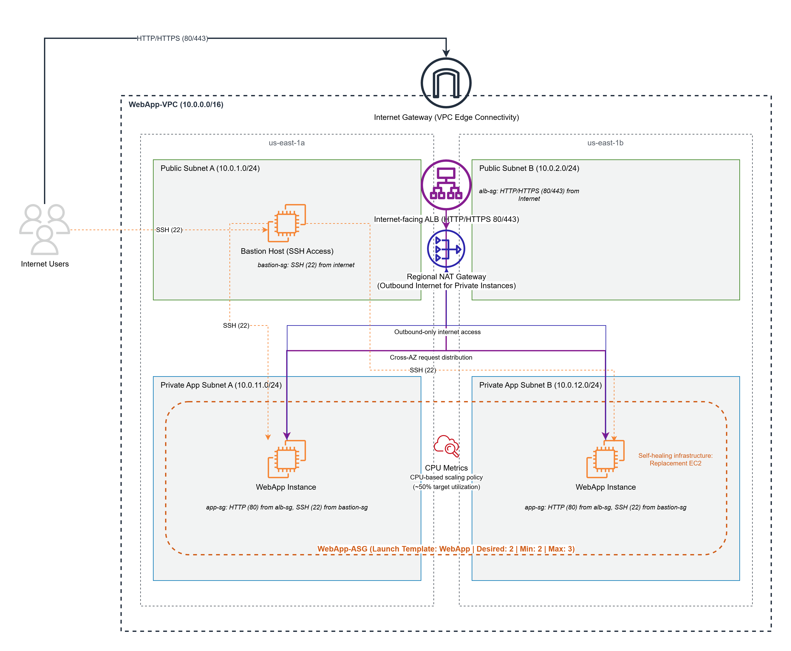

## Overview

I built this web app infrastructure project to demonstrate how an internet-facing application can run across multiple Availability Zones in AWS. The design uses an Application Load Balancer (ALB), private EC2 application instances, and an Auto Scaling Group.

The ALB receives HTTP requests in the public subnets and forwards them to the application instances in the private subnets. The Auto Scaling Group maintains two instances at its desired capacity and can launch a third when average CPU utilization reaches its target. It also replaces an instance if it is terminated.

I focused on three behaviors: whether requests reached both application instances, whether CPU load triggered scale-out, and whether the group replaced a terminated instance.

## Network layout

The VPC uses `10.0.0.0/16` in `us-east-1`. I divided it into public and private application subnets across `us-east-1a` and `us-east-1b`.

| Tier | Subnet | Availability Zone | CIDR |
|---|---|---|---|
| Public | Public Subnet A | `us-east-1a` | `10.0.1.0/24` |
| Public | Public Subnet B | `us-east-1b` | `10.0.2.0/24` |
| Application | Private App Subnet A | `us-east-1a` | `10.0.11.0/24` |
| Application | Private App Subnet B | `us-east-1b` | `10.0.12.0/24` |

The Internet Gateway provides internet connectivity for the public subnets. A Regional NAT Gateway gives the private application instances outbound internet access.

**VPC overview**

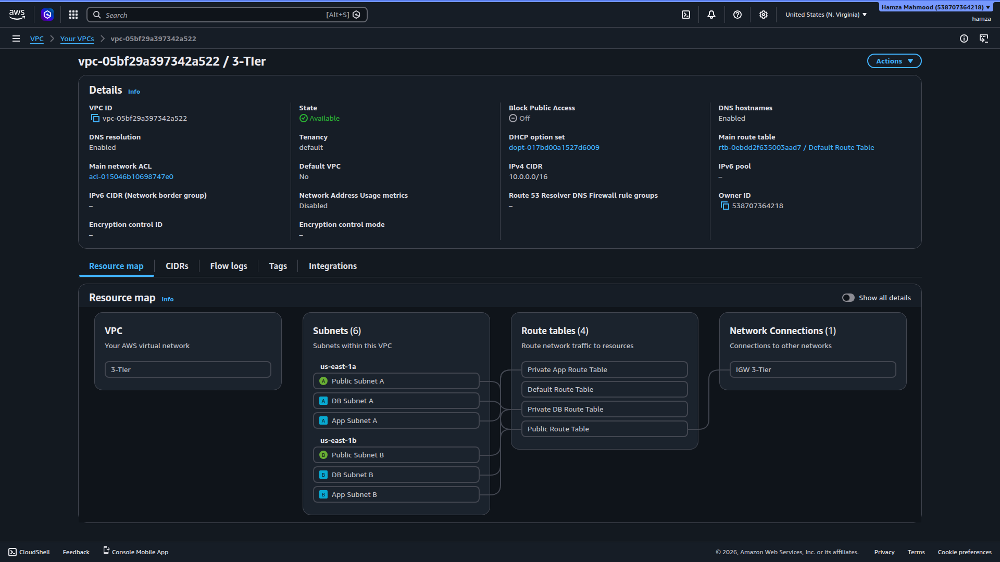

**Subnet layout**

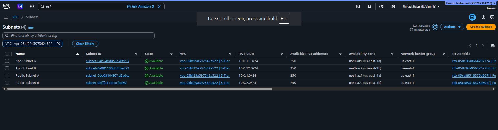

**Subnet details:** [Public Subnet A](screenshots/2-2-1-public-subnet-a.png) · [Public Subnet B](screenshots/2-2-2-public-subnet-b.png) · [Private App Subnet A](screenshots/2-2-3-app-subnet-a.png) · [Private App Subnet B](screenshots/2-2-4-app-subnet-b.png)

## Routing and internet access

Separate route tables handle the public and private application subnets.

| Route table | Default route | Purpose |
|---|---|---|
| Public | `0.0.0.0/0` → Internet Gateway | Internet access for public resources |
| Private application | `0.0.0.0/0` → Regional NAT Gateway | Outbound internet access for private EC2 instances |

The private instances can download packages and updates without public IP addresses. They do not need a direct inbound route from the internet.

**Private application route table**

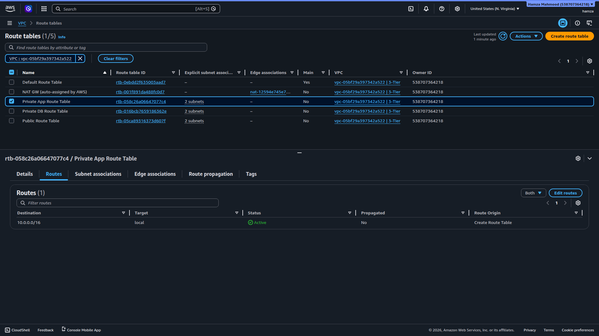

**Additional routing configuration:** [Public route table routes](screenshots/5-1-1-public-route-table-routes.png) · [Public route table associations](screenshots/5-1-2-public-route-table-subnets.png) · [Private app route table associations](screenshots/5-2-2-app-route-table-subnets.png) · [Internet Gateway](screenshots/3-1-internet-gateway.png) · [Regional NAT Gateway](screenshots/4-1-nat-gateway.png)

## Network security

Security groups control traffic between the ALB, application instances, and bastion host.

| Security group | Inbound access |
|---|---|
| `alb-sg` | HTTP (80) and HTTPS (443) from `0.0.0.0/0` |
| `app-sg` | HTTP (80) from `alb-sg`, SSH (22) from `bastion-sg` |
| `bastion-sg` | SSH (22) from `0.0.0.0/0` |

The application instances accept HTTP traffic only from `alb-sg`. SSH access to the private instances is allowed from the bastion security group.

The bastion's SSH rule is open to the internet in this lab configuration. In a production environment, I would restrict it to a trusted source IP range.

**Security group configuration:** [ALB security group](screenshots/6-1-alb-security-group.png) · [Application security group](screenshots/6-2-app-security-group.png) · [Bastion security group](screenshots/6-4-bastion-sg.png)

## Application Load Balancer

The internet-facing ALB runs in the public subnets. Its `WebApp-TG` target group contains the EC2 instances in the private application subnets. HTTP health checks determine which targets are healthy and can receive requests.

The ALB is named `WebApp-TG`, but I intended to name it `WebApp-ALB`. The target group is also named `WebApp-TG`. The ALB has an HTTP listener on port `80`. The `alb-sg` security group allows traffic on port `443`, but I did not configure an HTTPS listener or certificate.

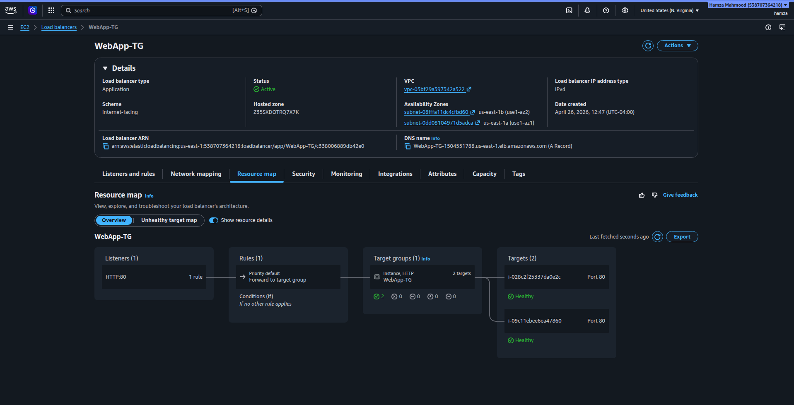

**ALB configuration:** [ALB overview and DNS](screenshots/7-3-1-alb-overview-dns.png) · [ALB Availability Zones](screenshots/7-3-2-alb-availability-zones.png) · [Target group overview](screenshots/7-2-1-target-group-overview.png) · [Target group health check](screenshots/7-2-2-target-group-health-check.png)

## EC2 launch template and Auto Scaling

The `WebApp` launch template defines the EC2 instance configuration. Its user-data script installs and starts Apache (`httpd`). It also uses IMDSv2 to retrieve the instance ID and Availability Zone. The web page displays those values and the hostname, so each response identifies the instance that handled the request.

### EC2 user data

I added this script to the `WebApp` launch template. It installs Apache, enables the service at boot, retrieves instance metadata through IMDSv2, and writes the instance details to the default web page.

```bash
#!/bin/bash
dnf update -y
dnf install -y httpd
systemctl start httpd
systemctl enable httpd

TOKEN=$(curl -s -X PUT "http://169.254.169.254/latest/api/token" -H "X-aws-ec2-metadata-token-ttl-seconds: 21600")

INSTANCE_ID=$(curl -s -H "X-aws-ec2-metadata-token: $TOKEN" http://169.254.169.254/latest/meta-data/instance-id)

EC2_AVAIL_ZONE=$(curl -s -H "X-aws-ec2-metadata-token: $TOKEN" http://169.254.169.254/latest/meta-data/placement/availability-zone)

echo "<h1>Hostname: $(hostname -f)</h1>" > /var/www/html/index.html
echo "<h1>Instance ID: $INSTANCE_ID</h1>" >> /var/www/html/index.html
echo "<h1>AZ: $EC2_AVAIL_ZONE</h1>" >> /var/www/html/index.html
```

The `WebApp-ASG` Auto Scaling Group uses the launch template and spans the private application subnets in both Availability Zones.

| Setting | Configuration |
|---|---|
| Launch template | `WebApp` |
| Auto Scaling Group | `WebApp-ASG` |
| Desired capacity | 2 |
| Minimum capacity | 2 |
| Maximum capacity | 3 |
| Scaling policy | Target tracking based on average CPU utilization |
| CPU utilization target | Approximately 50% |
| Attached target group | `WebApp-TG` |

The target tracking policy adjusts capacity based on average CPU utilization. I also terminated an EC2 instance to verify that the group launched a replacement.

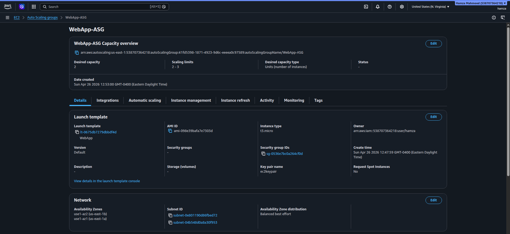

**EC2 and Auto Scaling configuration:** [Launch template overview](screenshots/7-1-1-launch-template-overview.png) · [Launch template user data](screenshots/7-1-2-launch-template-user-data.png) · [Target group attachment](screenshots/7-4-2-asg-target-group-attachment.png) · [Target tracking policy](screenshots/7-4-3-asg-target-tracking-policy.png)

## Validation

I tested the application through the ALB and checked how the Auto Scaling Group responded to CPU load and instance termination.

### Load balancing

Requests to the ALB DNS name reached both application instances. Each page displayed the instance ID and Availability Zone, which let me identify the instance that handled each request.

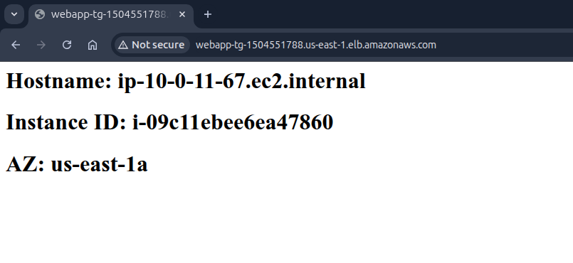

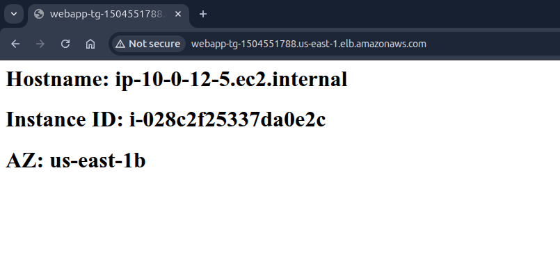

### Auto Scaling scale-out

I generated CPU load on an application instance with the command in [`configs/stress-command.sh`](configs/stress-command.sh):

```bash
stress-ng --cpu 4 --cpu-load 90 --timeout 300s
```

Average CPU utilization exceeded the target, and the Auto Scaling Group launched a third instance. The new instance registered with the target group and became healthy.

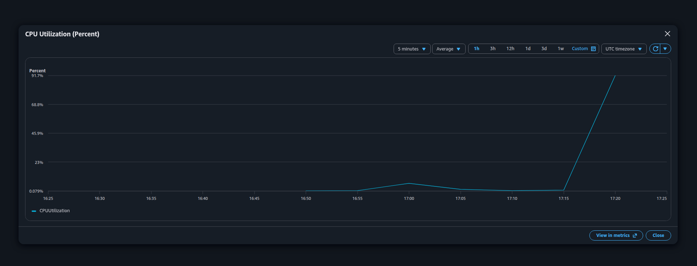


The ALB resource map showed the third instance as a target. I then sent another request through the ALB to confirm that the new instance received traffic.

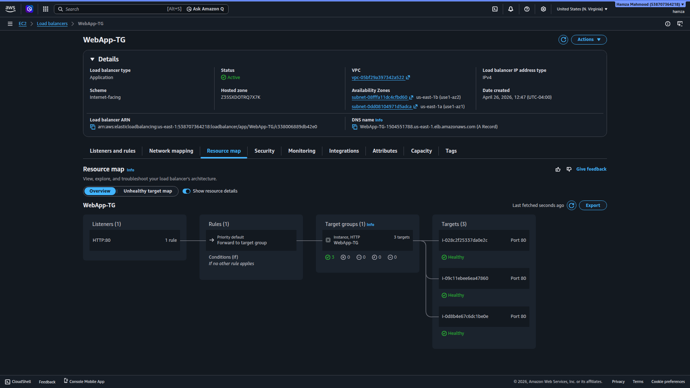

**Scale-out evidence:** [Stress command on instance A](screenshots/9-1-1-stress-command-a.png) · [Stress command on instance B](screenshots/9-1-2-stress-command-b.png) · [Scale-out activity](screenshots/9-1-4-asg-activity-launching-instance.png) · [Three EC2 instances](screenshots/9-1-5-ec2-three-instances.png) · [Response from third instance](screenshots/9-1-8-alb-response-third-instance.png)

### Instance replacement

I manually terminated an EC2 instance to test the Auto Scaling Group's replacement behavior. The group detected that it was below its desired capacity and launched another instance.

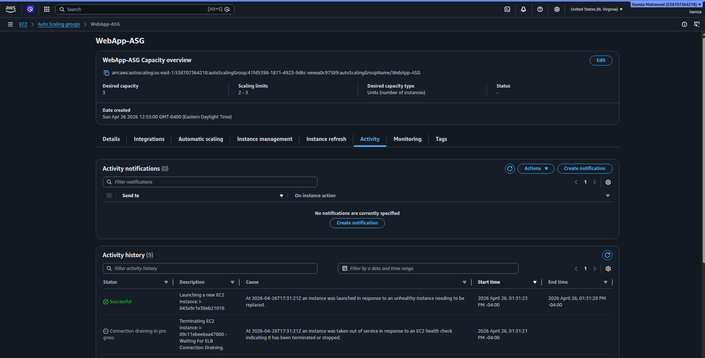

The replacement instance became healthy and responded to a request through the application.

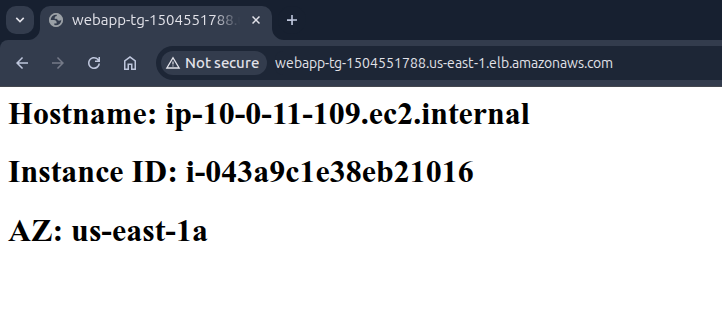

Supporting screenshots: [Terminated instance](screenshots/10-1-1-instance-terminated.png) · [Auto Scaling response](screenshots/10-1-2-asg-response.png)

### Final state

The final check showed the Auto Scaling Group at its desired capacity, with both instances healthy.

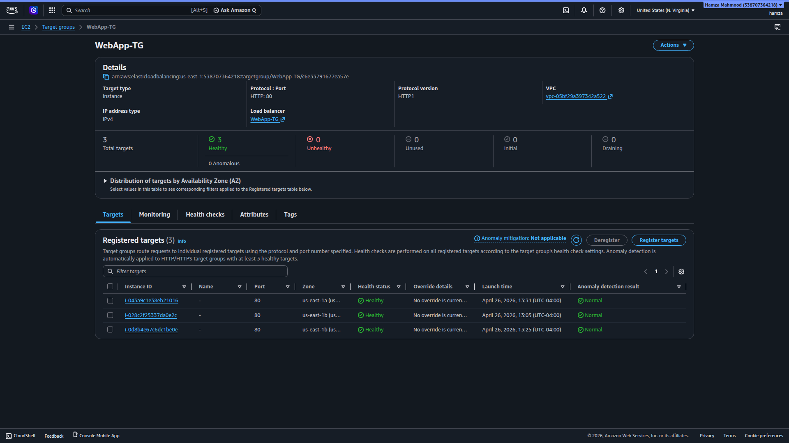

## Project files

The repository contains the architecture diagram, its editable draw.io source, the EC2 user-data and stress-test scripts, and screenshots of the configuration and validation.

- **[architecture/](./architecture/)**: PNG architecture diagram and editable draw.io source.
- **[configs/](./configs/)**: EC2 user-data script and CPU stress-test command.
- **[screenshots/](./screenshots/)**: VPC, subnet, route table, security group, load balancer, Auto Scaling, and validation evidence.