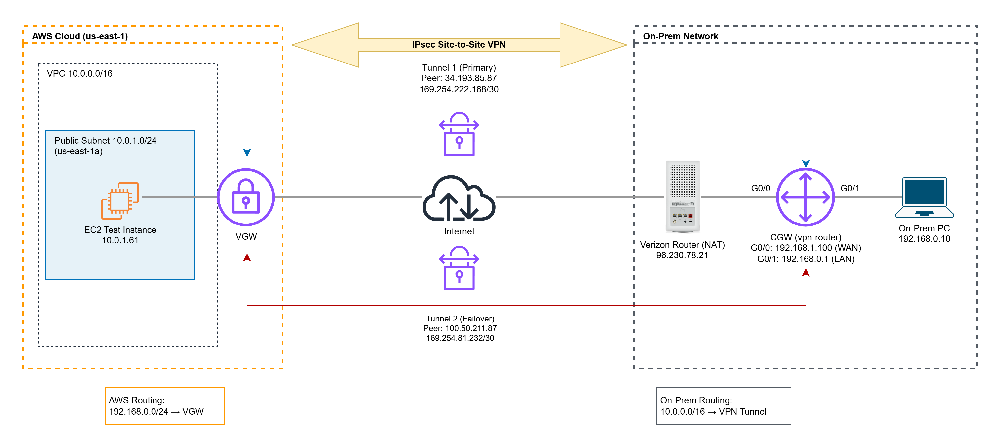
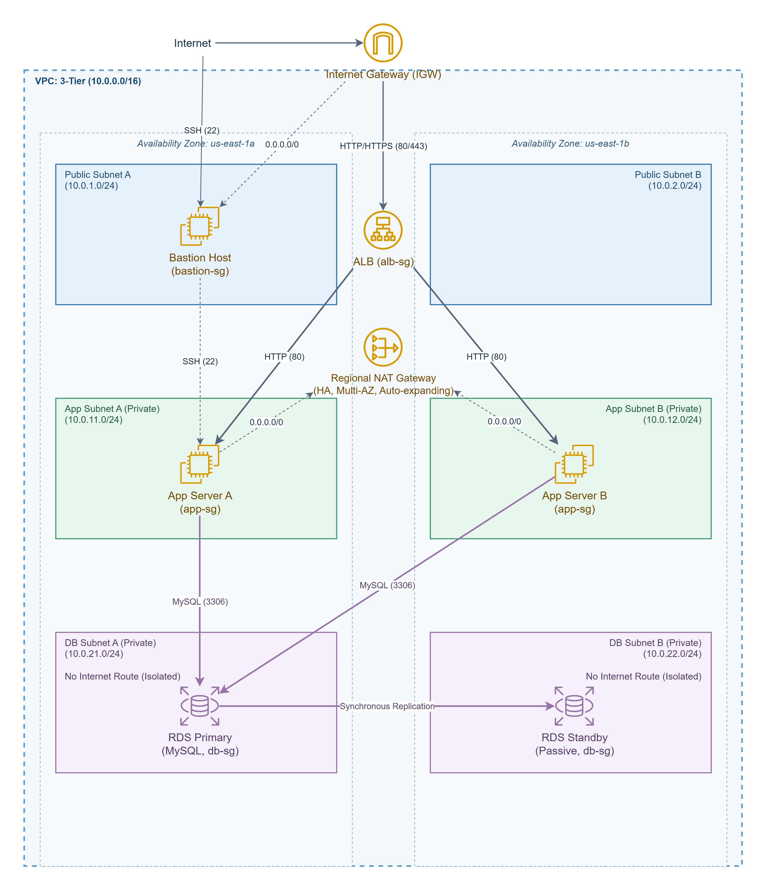
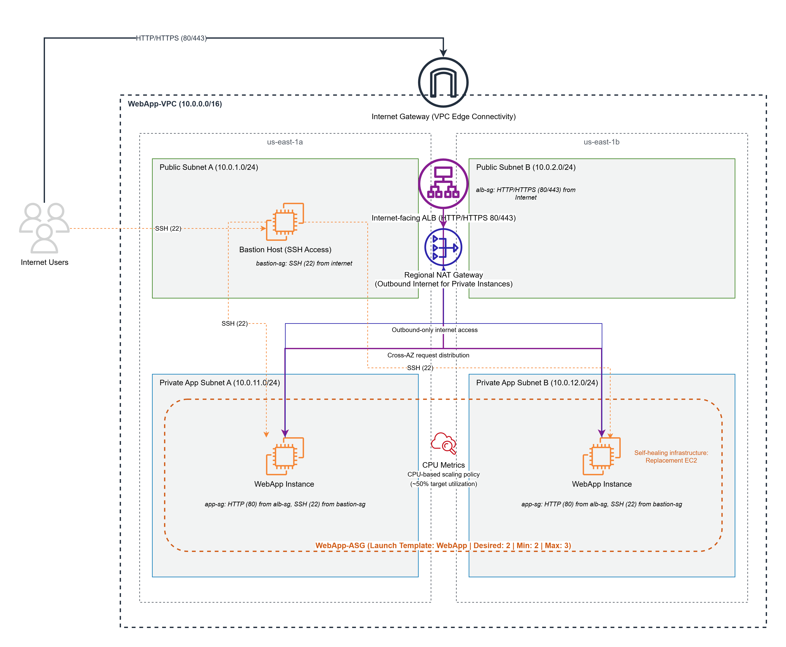
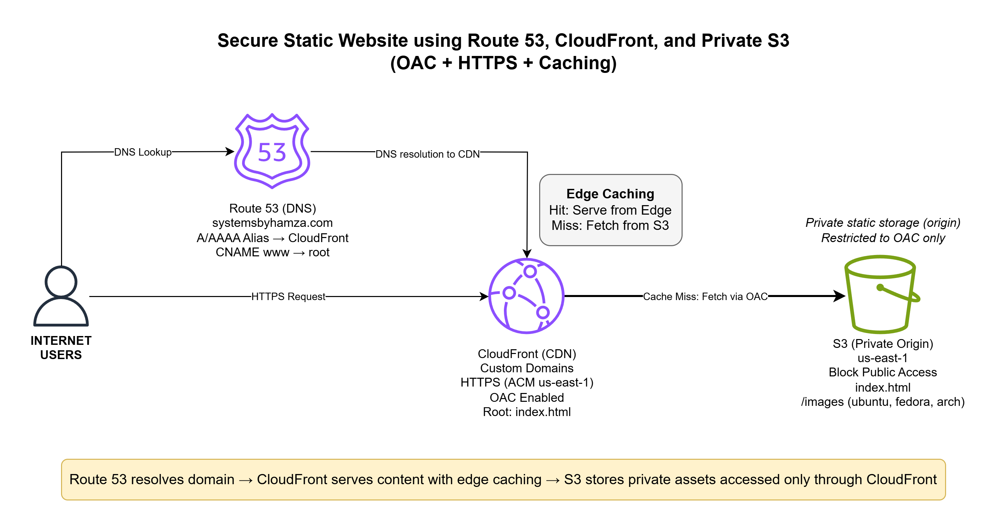

# AWS Cloud Architecture Portfolio

## Introduction

After earning the AWS Certified Cloud Practitioner and AWS Certified Solutions Architect – Associate certifications, I wanted to build projects that demonstrate the skills I had developed and apply my knowledge of AWS in practical scenarios.

This portfolio brings together four AWS projects that cover hybrid connectivity, VPC architecture, high availability, and content delivery. Each project documents the architecture, configuration, and testing carried out. The projects also include architecture diagrams, configuration files, and screenshots that provide evidence of the implementation and validation.

## Projects

### [1. Site-to-Site VPN](01-site-to-site-vpn/README.md)

This project connects a simulated on-premises network in GNS3 to an AWS VPC through an AWS Site-to-Site VPN. A Cisco IOSv router establishes the VPN connection through an AWS Virtual Private Gateway. The VPN uses two IPsec tunnels, with IP SLA and object tracking on the router to monitor connectivity and control route selection. I tested ping and SSH in both directions across the VPN. I also shut down Tunnel 1 to verify that traffic switched to Tunnel 2.

### [2. Three-Tier VPC Architecture](02-three-tier-vpc/README.md)

This project builds a three-tier VPC architecture across two Availability Zones in AWS. Public subnets host the internet-facing Application Load Balancer and bastion host, while private application subnets contain the EC2 instances. Amazon RDS for MySQL provides the database tier through a Multi-AZ deployment. Separate route tables and security groups control traffic between the tiers. I tested load balancing, application-to-database connectivity, outbound access through the Regional NAT Gateway, and application availability after one EC2 instance became unavailable.

### [3. Highly Available Web App](03-web-app-infrastructure/README.md)

This project deploys an internet-facing web application across two Availability Zones. An Application Load Balancer distributes HTTP requests to private EC2 instances that belong to an Auto Scaling Group. The group maintains a desired capacity of two instances and can scale out to three based on average CPU utilization. The launch template uses EC2 user data to install Apache and display instance metadata on the web page. I tested load balancing, CPU-based scale-out, and automatic instance replacement after termination.

### [4. CloudFront and Route 53](04-content-delivery-and-dns/README.md)

This project hosts a static website in a private Amazon S3 bucket and delivers it through Amazon CloudFront. Route 53 provides DNS records for the root domain and the `www` subdomain. CloudFront uses Origin Access Control to access the S3 origin, while the bucket policy restricts access to the distribution. An ACM certificate provides HTTPS for both custom domains. I tested website access, direct S3 access restrictions, DNS resolution, CloudFront cache hits and misses, and cache invalidation.